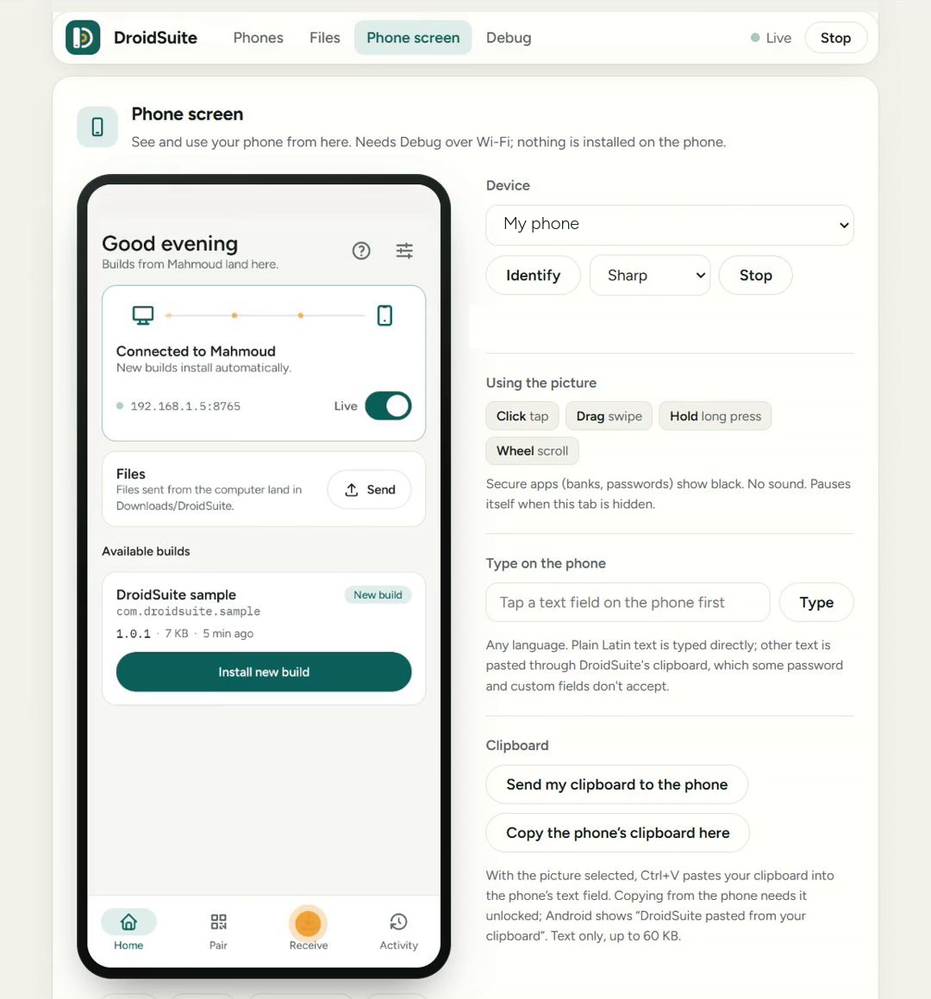

<p align="center">
  
</p>

<h1 align="center">DroidSuite</h1>

<p align="center"><strong>Your Android phone, on your computer. No cable.</strong></p>

<p align="center">
  <a href="https://www.npmjs.com/package/droidsuite"></a>
  
  
  
</p>

<p align="center">
  <a href="docs/getting-started.md">Get started</a> ·
  <a href="docs/README.md">Documentation</a> ·
  <a href="docs/troubleshooting.md">Troubleshooting</a> ·
  <a href="https://github.com/Mahmoud-Helmy-m/DroidSuite/issues/new/choose">Report a problem</a>
</p>

---

See and control your phone from a browser, type on it from your keyboard, copy files both ways, and install apps, all over your own Wi-Fi. There's no account, and your files and screen don't go through any DroidSuite server.

<p align="center">
  
</p>

## What you can do

| Feature | What you get |
|---|---|
| **See and control the screen** | Live view in your browser. Click to tap, drag to swipe. |
| **Type from your keyboard** | Any language, including Arabic. |
| **Copy between devices** | Send a PIN or a link from one to the other. |
| **Copy files both ways** | Drop files on the page, or use Share on the phone. |
| **Send from any computer** | Any browser can send files to your phone, with nothing to install on that computer. |
| **Work without a router** | Use your computer's own Wi-Fi hotspot. |

### For Android developers

| Feature | What you get |
|---|---|
| **Live builds** | Every new APK from your build folder reaches the phone by itself. |
| **Debug over Wi-Fi** | adb, logcat and Android Studio, with no cable. |
| **AI agents** | Claude Code, Codex and other agents can install your app on a real phone, open it and check it starts. |

## Install

**Have Node.js 20 or newer?** One line, in any terminal:

```bash
npx droidsuite@latest setup
```

**Don't have Node.js?** These install it for you where they can.

Windows: press <kbd>Win</kbd>+<kbd>R</kbd>, paste, press <kbd>Enter</kbd>:

```powershell
powershell -NoExit -ExecutionPolicy Bypass -Command "irm https://cdn.jsdelivr.net/npm/droidsuite/install.ps1 | iex"
```

Mac or Linux:

```bash
curl -fsSL https://cdn.jsdelivr.net/npm/droidsuite/install.sh | sh
```

Setup adds a **DroidSuite** icon. Open it, then follow [Get started](docs/getting-started.md) to connect your phone. It takes about 10 minutes the first time.

## Documentation

| Guide | What's in it |
|---|---|
| [Get started](docs/getting-started.md) | Install, get the phone app, connect, and update |
| [Phone screen](docs/phone-screen.md) | Live view, control, typing and clipboard |
| [Files](docs/files.md) | Copying files both ways, with or without pairing |
| [Install apps and builds](docs/builds.md) | Sending apps to your phone, and Live builds |
| [Debug over Wi-Fi](docs/debugging.md) | Developer options, wireless debugging, Android 8–10 |
| [AI coding agents](docs/ai-agents.md) | Let an agent test your app on a real phone |
| [Commands](docs/commands.md) | Every command and option |
| [Android versions](docs/android-versions.md) | What works on each version |
| [Troubleshooting](docs/troubleshooting.md) | Fixes for common problems |
| [Privacy and security](docs/privacy.md) | What stays on your network, and what doesn't |

## Status

DroidSuite is in beta. This is what it has been tested on so far:

| Tested on | Result |
|---|---|
| **Windows 11** | Tested, including the one-line installer |
| **Linux** | Installer tested on Ubuntu under WSL |
| **macOS** | Not tested yet. Reports are very welcome. |
| **Phones** | A Xiaomi phone on Android 13, and the Android 13 emulator |

Tried it on something else? [Tell us how it went](https://github.com/Mahmoud-Helmy-m/DroidSuite/issues/new/choose), good or bad.

## Get help

- **Something's broken:** [report a bug](https://github.com/Mahmoud-Helmy-m/DroidSuite/issues/new?template=bug_report.yml).
- **An idea:** [suggest a feature](https://github.com/Mahmoud-Helmy-m/DroidSuite/issues/new?template=feature_request.yml).
- **A security problem:** please read the [security policy](SECURITY.md) first, and don't open a public issue.

> [!IMPORTANT]
> Issues are public. Never post your pairing QR code, a pairing code, or a PIN.

## About this repository

This repository holds the documentation and the issue tracker. The program itself is distributed through [npm](https://www.npmjs.com/package/droidsuite).

Made by Mahmoud Helmy. [MIT License](LICENSE).
