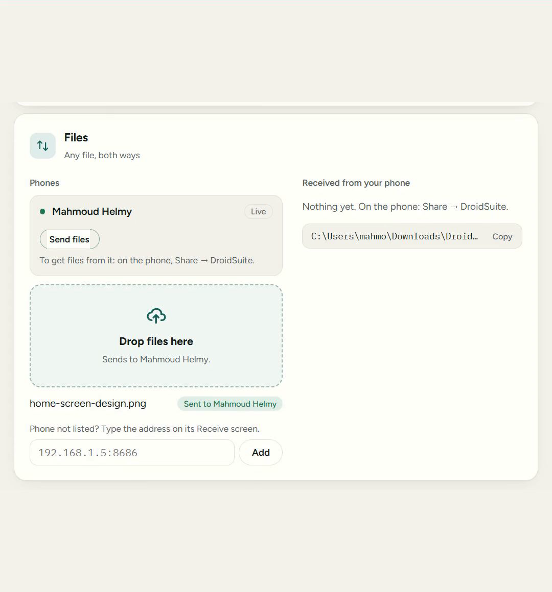
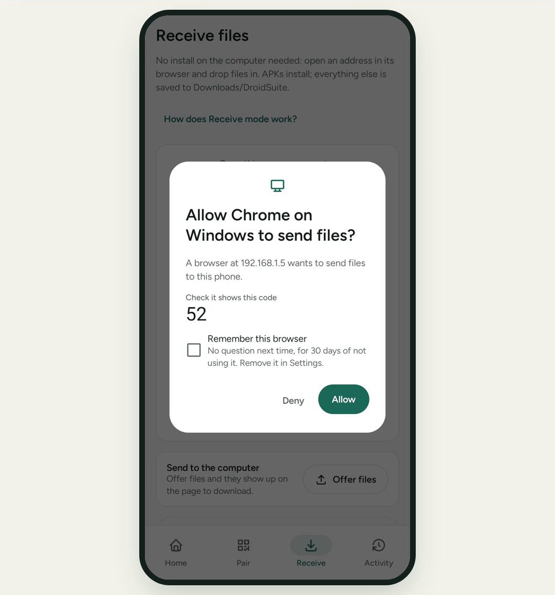

# Files

Copy any file between your phone and a computer.



| You want to | Use |
|---|---|
| Send to or from **your own** computer | [Paired](#your-paired-computer) |
| Use **any other** computer, or skip pairing | [Receive mode](#receive-mode-no-pairing) |

## Your paired computer

Start DroidSuite on the computer. The phone needs **Live** on to receive files.

**Computer to phone:** on the page, go to **Files**, then click **Send files** on your phone's row, or drop files on it. They arrive in `Downloads/DroidSuite`, with a notification.

**Phone to computer:** in any app, tap **Share → DroidSuite** and pick your computer. Files land in `Downloads/DroidSuite` on the computer, and the page lists them under **Received from your phone**.

> [!NOTE]
> On Android 8 and 9, files sent to the phone stay in DroidSuite's own folder. Open them from the app.

Transfers between a paired phone and computer are checked, so a damaged file is caught.

## Receive mode: no pairing

Use this with a computer that isn't paired, including one with nothing installed.

On the phone, tap **Receive → Start receiving**.

### On a computer with DroidSuite

1. The phone appears under **Files → Phones**. It can take up to 30 seconds.
2. Click **Connect** on its row. A paired computer connects at once. Otherwise, tap **Allow** on the phone if it shows the same two-digit code, or type the phone's PIN.
3. Click **Send files** to send, or **Get** beside a file the phone offers.

Phone not listed? Type the address from the phone's **Receive** screen under the list, and click **Add**.

### On any other computer



1. Type the address shown on the phone into the computer's browser.
2. If the phone shows the same two-digit code as the browser, tap **Allow**. Or type the PIN in the browser.
3. Drop files on the page. Apps install, and other files are saved.

**To get files from the phone:** tap **Offer files**, choose them, then click **Download** on the page.

Tap **Stop receiving** when you're done.

> [!TIP]
> Tick **Remember this browser** before **Allow** to skip the question next time. It expires after 30 days without use, and you can remove it in **Settings → Trusted browsers**.

## From the terminal

```bash
droidsuite push photo.jpg                   # to your phones on Live
droidsuite send report.pdf --to 192.168.1.23 --pin 123456   # to a phone in Receive mode
droidsuite get --out ./from-phone           # get what the phone offers
```

See [Commands](commands.md) for every option.

---

**Next:** [Install apps and builds](builds.md) · [Troubleshooting](troubleshooting.md)
