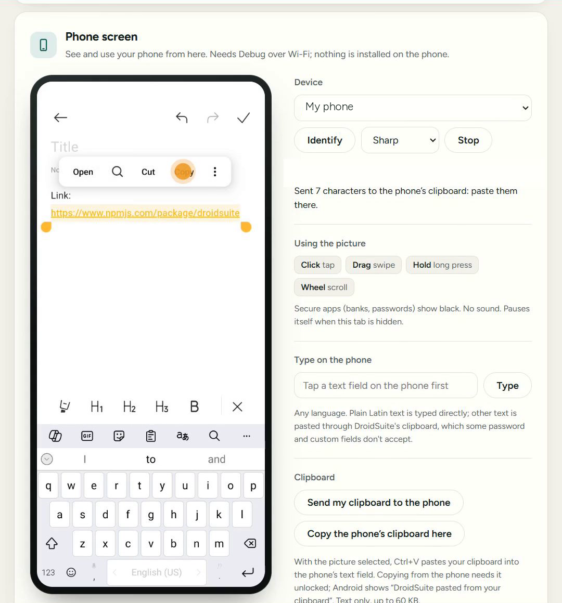

# Phone screen

See your phone in your browser, and use it with your mouse and keyboard.

> [!IMPORTANT]
> This needs [Debug over Wi-Fi](debugging.md) connected first. Pairing the phone app alone isn't enough.

## Start the view

1. Unlock your phone.
2. On the page, go to **Phone screen** and choose your phone under **Device**. **Identify** wakes the selected phone, so you can check it's the right one.
3. Choose a quality, then click **Start**.

| Quality | Best for |
|---|---|
| **Data saver** | A weak connection |
| **Balanced** | Most of the time |
| **Sharp** | Reading small text |

## Control it

| Do this | To |
|---|---|
| Click | Tap |
| Drag | Swipe |
| Hold | Long press |
| Mouse wheel | Scroll |
| <kbd>Esc</kbd> | Go back |
| <kbd>H</kbd> | Go home |

**Back**, **Home**, **Recent apps** and **Wake** are also under the picture.

## Type on the phone

Tap a text field on the phone, enter text under **Type on the phone**, and click **Type**. Any language works, up to 200 characters at a time.

Plain Latin text is typed directly. Anything else, such as Arabic or emoji, goes through the clipboard and is pasted, so it replaces what the phone had copied. Some password fields refuse paste.

## Copy between devices

| To | Do this |
|---|---|
| Send from computer to phone | Copy on the computer, click **Send my clipboard to the phone**, then paste on the phone. |
| Bring from phone to computer | Unlock the phone, copy there, click **Copy the phone's clipboard here**, then paste on the computer. |
| Paste into a phone field | With the view running, tap the field, select the picture, and press <kbd>Ctrl</kbd>+<kbd>V</kbd>. |

Text only, up to 60 KB. The phone's clipboard is read only when you click that button.

## Good to know

- The view **pauses** when the tab is hidden for 15 seconds, or after about 5 minutes without input. Click **Resume**.
- **Banking and password screens** can appear black. That's Android protecting them.
- There's **no sound**, and only the main display is shown.
- On **Android 13 and older**, the picture restarts briefly about every 3 minutes, then comes back by itself.
- The **Stop** inside this section ends the view. The **Stop** at the top right ends DroidSuite.

> [!NOTE]
> **Xiaomi, Redmi, POCO:** to control the phone, turn on **Developer options → USB debugging (Security settings)**, then restart it. Viewing works without this.

## Smoother on a hotspot

A busy router adds delay. Connecting the phone directly to your computer's hotspot can help.

1. Turn on the hotspot. On Windows: **Settings → Network & internet → Mobile hotspot**.
2. Connect the phone to it.
3. Turn **Wireless debugging** back on if it switched off, then click **Connect over Wi-Fi** on the page.

This works best when the computer gets its internet over Ethernet.

---

**Next:** [Files](files.md) · [Troubleshooting](troubleshooting.md)
